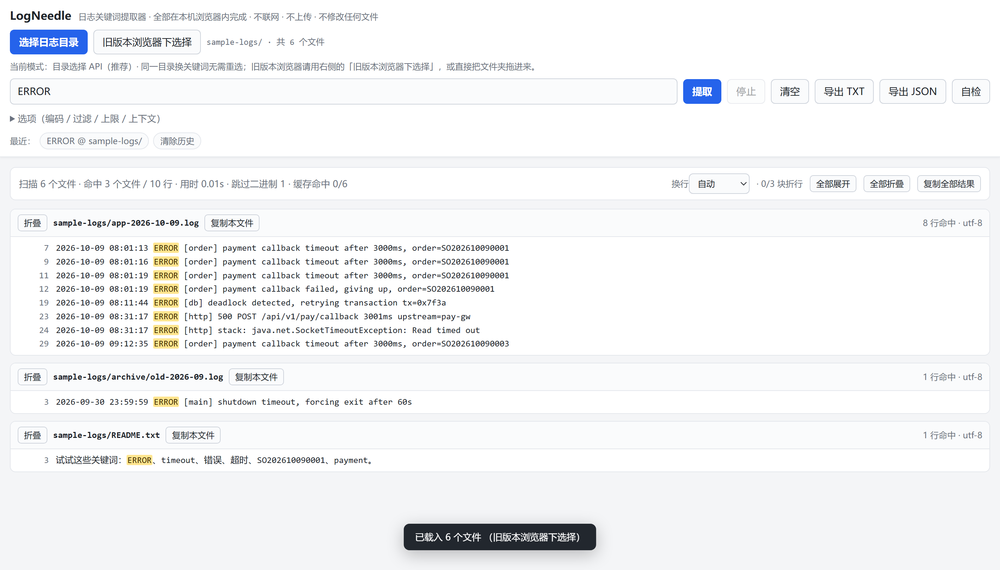
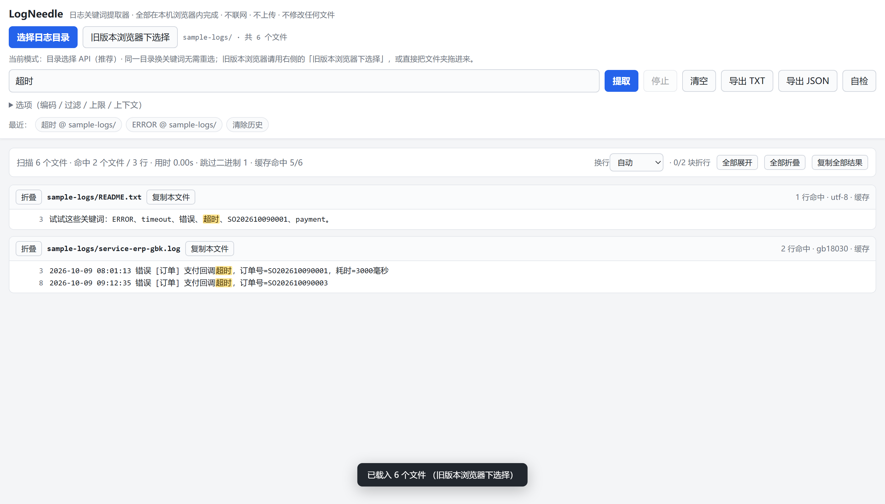

# LogNeedle

English | [简体中文](README.zh-CN.md)

[](LICENSE)


**Search a folder full of logs from a single HTML file — in the browser you already have.**

No install, no server, no upload, no admin rights. Double-click the file, pick a folder, type a keyword, read the hits.

## Demo





Both screenshots are generated by `tools/screenshot.ps1` against `examples/sample-logs/`.

**Live demo:** https://dryQAQ.github.io/LogNeedle/ — the intended way to use LogNeedle is still to download the file and open it locally; the demo exists so you can look before you download.

## Quick start

1. **Download `logneedle.html`** — one file, about 68 KB. On GitHub, open the file and use *Download raw file*.
2. **Double-click it.** It opens in your default browser. That is the entire installation.
3. **Click 选择日志目录** ("Choose log folder") and pick the folder that holds your logs — or drag the folder onto the page.
4. **Type a keyword and press Enter.**
5. Hits appear below, one card per file, with the keyword highlighted and line numbers pinned on the left.
6. **Click 清空** ("Clear") and type the next keyword. The folder stays loaded and parsed files stay cached, so the second search does not touch the disk again.

Edge or Chrome give you the best path (a real directory handle). Firefox and Safari work through the system folder picker — the button next to it, **旧版本浏览器下选择**.

Nothing else is required: no Python, no Node, no npm, no extension, no elevation prompt.

## Why this exists

- **You cannot install anything.** Production hosts, jump boxes and locked-down VDI images often have a browser and nothing else. `ripgrep`, `lnav` and `klogg` need an install you are not allowed to perform.
- **The logs are confidential.** Everything happens inside the tab: no upload, no telemetry, no CDN, no fonts fetched from anywhere. You can confirm that in DevTools → Network.
- **The logs are GBK.** Chinese Windows services still write GBK/GB18030 logs, and most tools show them as mojibake. LogNeedle detects the encoding per file and has a manual override when the guess is wrong.
- **Only a browser is available.** Air-gapped networks, Citrix sessions, kiosk machines where you can open a local HTML file but cannot run an installer.
- **You want to hand it to someone.** One file. Send it in chat, put it on a share, attach it to a ticket. It still works.

## Features

| Area | What you get |
|---|---|
| Getting a folder | File System Access API picker (Chromium), system folder picker (any browser), or drag & drop a folder or loose files onto the page |
| Results | One collapsible card per file: relative path, hit count, detected encoding, sticky line numbers, highlighted matches |
| Wrapping | Auto / always / never. Auto measures each card's real overflow and wraps only what has to wrap; it re-measures on window resize and on expand/collapse |
| Matching | Literal or regular expression, case-sensitivity toggle, multi-keyword OR (separated by spaces or a `\|`), 0–10 lines of context |
| Filtering | Sub-path filter (`2024-05`), file globs (`*.log;*.txt`), and automatic skipping of `.git`, `node_modules`, `$RECYCLE.BIN`, `$WinREAgent`, `System Volume Information`, `Recovery`, `__pycache__`, `.svn`, `.hg`, `.idea`, `.vscode`, `venv`, `.venv` |
| Encodings | UTF-8 (±BOM), UTF-16LE/BE (±BOM, plus a byte-distribution sniff when the BOM is missing), GBK/GB18030, Big5 — decided per file, overridable |
| Big folders | Files up to 8 MB are read whole and cached (LRU, 192 MB budget); larger files stream in 1 MB chunks; binary files are skipped; a stop button ends a long scan |
| Limits | Per-file cap (default 200 lines) and total cap (default 5000), both adjustable, with a visible "capped" marker instead of silent truncation |
| Output | Copy one card, copy everything, export TXT (UTF-8 with BOM, so Notepad and Excel open it correctly) or JSON |
| Self-check | The in-page 自检 button runs 29 assertions, including GBK byte fixtures and streaming-decode edge cases |
| Privacy | Zero network requests, read-only folder access, nothing added to your logs |

## How it compares

| | ripgrep | `grep` + `less` | klogg | lnav | **LogNeedle** |
|---|---|---|---|---|---|
| Needs an install | yes (a binary) | no | yes (desktop app) | yes | **no — one HTML file** |
| Interface | terminal | terminal | desktop GUI | terminal UI | **your browser** |
| Per-file grouping and highlighting | plain matches | plain matches | yes | yes | **yes** |
| Usable with no install rights | often blocked | yes | rarely | rarely | **yes** |
| Per-file encoding detection (GBK, UTF-16) | no | no | partial | partial | **yes** |
| Live follow (`tail -f`) | no | yes (`less +F`) | yes | yes | **no** |
| Speed on very large trees | excellent | excellent | good | good | **fine for thousands of files; slower than `rg`** |
| Can be sent to a colleague as one file | no | no | no | no | **yes** |

If you are allowed to install ripgrep, install ripgrep: it is faster, scriptable, and better at almost everything in that table. LogNeedle exists for the two cases `rg` cannot cover — a machine where you cannot install anything, and a log whose encoding turns into garbage in a terminal.

## What it is not

- **Not a log collector or aggregator.** Nothing ships anywhere, nothing is indexed in the background, there is no server component and no account.
- **Not `tail -f`.** There is no live following and no watching; you run a search again after the log grows. For live tails, `less +F`, `lnav` or `Get-Content -Wait` are the right tools.
- **Not built for multi-gigabyte single files.** Large files do stream, but the browser tab becomes the bottleneck long before the tool does; expect slow scans and a heavy page.
- **Not a redaction tool.** It shows matched lines exactly as they are. Nothing is uploaded, but nothing is masked either — treat your screen the way you would treat the file.
- **No compressed logs.** `.gz` and `.zip` members are not opened; decompress first.
- **No absolute-path input**, by design — see the FAQ below.
- **Not an editor.** LogNeedle never writes, renames or deletes anything in the folder you selected.

## Encoding support

| Encoding | Detection | Notes |
|---|---|---|
| UTF-8, no BOM | automatic | validated strictly; the default path |
| UTF-8 with BOM | automatic | the BOM is stripped before matching, so the first line matches like any other |
| UTF-16LE / UTF-16BE with BOM | automatic | |
| UTF-16 without BOM | automatic (heuristic) | recognised from where the NUL bytes fall; uncommon, but it happens |
| GBK / GB18030 | automatic (fallback) | GB18030 is a superset of GBK and GB2312, so one label covers both |
| Big5 | manual recommended | Traditional Chinese. Because GB18030 decodes almost any byte sequence, a Big5 file can be guessed as GB18030; pick Big5 in the 编码 dropdown if the text looks wrong |
| Shift_JIS, EUC-KR, Windows-1252 | manual | listed alongside the others; the dropdown marks any label your browser does not expose |

Manual override values in the 编码 dropdown: 自动检测, UTF-8, GBK, GB18030, Big5, Shift_JIS, EUC-KR, UTF-16LE, UTF-16BE, Windows-1252.

## FAQ

**Why can't I type a path like `D:\logs`?**
Because a web page cannot read arbitrary paths from disk. That is the browser's security model, and it applies to a local `file://` page too. So LogNeedle asks the browser for a folder — picker or drag & drop — and from then on only sees that folder, with relative paths. The upside is the whole reason the tool exists: no installer, no service, no permissions. If you need path input and a real filesystem walk, use a native tool.

**A log shows mojibake (乱码).**
Open 选项 → 编码 and switch from 自动检测 to GBK (or GB18030). Traditional Chinese files are usually Big5. Each card header shows the encoding that was actually used, so you can confirm it per file.

**Does it send my logs anywhere?**
No. The page makes no network requests at all: no scripts, no fonts, no images, no analytics, no error reporting. Open DevTools → Network, reload, and the list stays empty. `tools/check.mjs` fails the build if an `http(s)://` reference or an external resource ever appears in the file. The only thing stored locally is your last 10 searches and the wrap preference, in `localStorage` — clear them with the 清除历史 chip.

**Can it follow a live log?**
No. There is no `tail -f`, no file watching, no auto-refresh. The folder is read when you click 提取. For live tails, use `less +F`, `lnav`, or `Get-Content -Wait`.

**Does it work in Firefox or Safari?**
Yes, through the system folder picker (**旧版本浏览器下选择**), and drag & drop works there too. What you lose is the File System Access API path: that picker enumerates the whole tree before it returns, so a very large folder takes noticeably longer to open.

**How big a folder can it handle?**
Comfortably: a few thousand files and a few hundred megabytes per session. Files up to 8 MB are cached in memory (192 MB budget) and larger ones stream in 1 MB chunks, so the tool itself stays bounded — but rendering thousands of result cards and holding a large cache is still browser work. If a scan drags on, lower 每文件最多行 / 总计最多行, narrow the scan with 子目录过滤 or 文件通配, or press 停止 and refine the keyword.

**Why are some results marked as capped (已达到上限)?**
Because a per-file or total line limit was reached — 200 and 5000 by default. That is deliberate: it keeps the tab responsive when a keyword matches half the folder. Raise the limits in 选项, or narrow the keyword.

**The interface is in Chinese.**
Yes. English and other languages are the top roadmap item, and the UI strings are self-contained with no framework in the way, so a translation pull request is genuinely small. See [CONTRIBUTING.md](CONTRIBUTING.md).

**Does it modify my files?**
No. Folder access is requested read-only, and there is no code path that writes into the selected folder. The only files that leave the page are the TXT or JSON exports you explicitly ask for, saved through your browser's normal download flow.

## Privacy

What leaves your machine: nothing.

- The product file contains no `http://` or `https://` URL, no `<link>`, no `<script src>`, no `@import`, no `url(...)`. CI enforces this with `grep` on every push — see [`.github/workflows/ci.yml`](.github/workflows/ci.yml).
- There are no `fetch`, `XMLHttpRequest` or `WebSocket` calls in the code.
- Folder access is requested with `mode: 'read'` and can be revoked at any time from your browser's site settings.
- `localStorage` holds the last 10 search terms and your wrap preference. Nothing else is persisted.
- If you use the online demo, the page itself is fetched over HTTPS once, because that is how the web works; after it loads, the tool behaves exactly like the local file and still sends nothing.

To verify it yourself: open DevTools → Network, clear the panel, run a search, watch it stay empty. Or run `node tools/check.mjs logneedle.html` and read the "no external reference" assertions, or simply:

```bash
grep -nE 'https?://|fetch\(|XMLHttpRequest|new Worker' logneedle.html   # prints nothing
```

## Development and testing

```bash
git clone https://github.com/dryQAQ/LogNeedle.git
cd logneedle

node tools/check.mjs logneedle.html   # static + core logic, no dependencies
pwsh -File tools/screenshot.ps1       # end-to-end in headless Edge/Chrome, writes the screenshots
node tools/screenshot.mjs             # the same end-to-end run, cross-platform variant
```

- **`tools/check.mjs`** extracts both `<script>` blocks from `logneedle.html`, syntax-checks them, runs the very same 29-case suite the in-page 自检 button runs, validates the DOM id contract (every `$('id')` has a matching element), asserts that no external reference or banned API sneaked in, and measures match throughput. This is what CI runs.
- **`tools/screenshot.ps1`** drives a real headless browser over CDP: it loads the page from `file://`, picks `examples/sample-logs/`, types a keyword, clicks 提取, then asserts rendering, GBK decoding, the three wrap modes, 清空 followed by a second search, the in-page self-test, and a clean console. It writes `docs/screenshot.png` and `docs/screenshot-gbk.png`. **Verified on Windows.**
- **`tools/screenshot.mjs`** is the same run without PowerShell (it uses Node's built-in WebSocket). **Not verified on this machine** — it exists so the check can also run on Linux/macOS developer machines; treat it as best-effort until somebody runs it there.
- **`tools/mkdemo.py`** regenerates `examples/sample-logs/` if the demo data ever needs rebuilding (Python 3, optional — nothing else in the repository needs Python).
- **`examples/sample-logs/`** is the demo data: a UTF-8 service log, a GBK Chinese log, a JSONL file with very long lines, a nested subdirectory, a binary file (to prove binary skipping) and a text file with no matches. Its `README.txt` lists keywords worth trying, such as `ERROR`, `timeout`, `错误` and `payment`.

Recorded results on the machine used for this release (Windows, Node 24.19.0):

| Check | Result |
|---|---|
| `node tools/check.mjs logneedle.html` | **71 / 71 assertions pass** |
| In-page 自检 — the same suite, inside the browser | **29 / 29 pass** |
| Match throughput: 200,000 synthetic lines, ≈14.4 MB as UTF-16 in memory, match step only (file I/O and decoding excluded) | **88–141 ms, ≈140–190 MB/s** across runs |
| `tools/screenshot.ps1` — headless Edge 154 over CDP, 19 checks (load, folder pick, GBK decode, wrap modes, clear + re-search, in-page self-test, console) | **19 / 19 pass**; this is the most machine-dependent piece, re-run it locally |
| Console errors during the end-to-end run | none |

Your numbers will differ: throughput depends on the CPU and on how much of the work is decoding rather than matching.

## Roadmap

1. **English UI** (and any other language). The strings are self-contained and there is no framework to fight, which makes this the highest-value contribution available right now.
2. Keyboard-first navigation: jump between result cards, next/previous hit.
3. Remember the last folder where the File System Access API allows it, so a reload does not start from zero.
4. Field filters for structured logs (JSONL) — a light, offline selector, not a query language.
5. Not planned: writing to your log folder. LogNeedle stays read-only.

## Contributing

Bug reports, feature requests, translations and pull requests are all welcome — see [CONTRIBUTING.md](CONTRIBUTING.md). The short version: keep `logneedle.html` self-contained (no dependencies, no external references, no ES modules, no Workers, no `fetch`), run `node tools/check.mjs logneedle.html`, and update `CHANGELOG.md`.

Issue forms ask you not to paste real log content. Please redact or synthesize instead.

## License

MIT © 2026 LogNeedle contributors. See [LICENSE](LICENSE).
